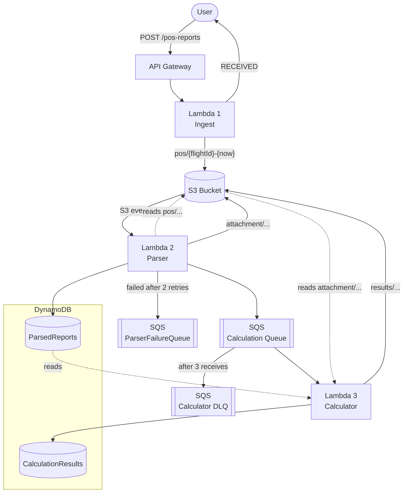
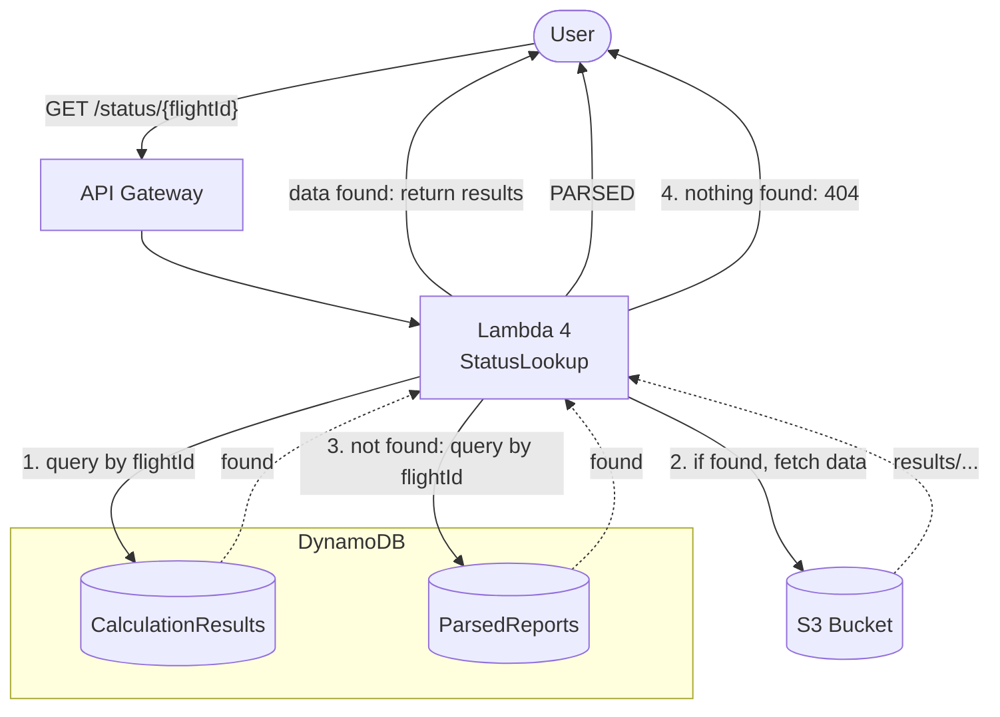

# Control Tower

## Goal

This project's goal is to be able to track a plane's info and internal status: 
- Flight ID
- Departure
- Arrival
- GPS coordinates
- Fuel stock
- Fuel consumption
- Speed
- Estimated time before arrival
- Estimated remaining fuel on arrival
- Whether if the plane will have enough fuel on arrival

---

## Requirements

- Node.js 20+ (tested with 22.14)
- .NET 10 SDK
- AWS cli configured with credentials
- CDK cli installed globally

Docker is not needed, since the bundling is performed locally.

## Installation

```
cd infra
npm ci
npx cdk bootstrap
npx cdk deploy
```

## Usage

1. Retrieve the api url from the deployed resource 
2. Run the following command:

```bash
curl -X POST "$API_URL/pos-reports" -H 'Content-Type: text/plain' \
  --data 'POS/UL204.FR RGN/TO BKK/041205/N1642.3E09612.5/450/12500/2800'
```
You should get the following in response:
```json
{"flightId": "UL20420261004RGNBKK","status": "RECEIVED"}
```

Note: the `20261004` part is dynamic since it matches the day the request was made, so I suggest directly copying the `flightId` you obtained in your console. .

3. To get the result of the calculation from the report sent previously, run the following command:
```bash
curl "$API_URL/status/UL20420261004RGNBKK"
```

4. If you were a bit too fast and the calculation isn't available yet, the following response will be sent back:
```json
{"flightId": "UL20420261004RGNBKK","status": "PARSED"}
```

5. Otherwise, the following response will be sent back:
```json
{
    "flightId": "UL20420261004RGNBKK",
    "timestamp": "2026-09-04T12:06:15.842Z",
    "remainingFlightTimeMinutes": 43,
    "estimatedFuelAtArrivalKg": 10513,
    "lowFuelWarning": false
}
```

## Flow

When a POST request is made to `/pos-reports`, the API Gateway transmits it to a 1st Lambda named `Ingest`. `Ingest` will handle the validation of the submitted payload, then parse it using the [PosReportParser](src/Shared/PosReportParser.cs), which will both validate the payload's data (ensuring all data are present, valid coordinates and date...), and returning it to `Ingest`. `Ingest` will then store a the raw report to S3 with both the calculated `flightId` from the request, with the timestamp of the HTTP request. After that, it will return `{"status":"RECEIVED"}` accompanied by the `flightId` to the user.

Storing this information will trigger an S3 Event, which will trigger a 2nd Lambda, `Parser`. `Parser` will extract the `flightId` and the timestamp from the previously stored data in the S3, and reuse the `PosReportParser` tool, excepted that, this time, it will format the data so it can be used for creating a [PosAttachment](src/Shared/PosAttachment.cs). From there, we store the result in S3 under the `attachment/` prefix, before storing the key in the `ParsedReports` table of the dynamoDB, so the S3 data can easily be retrieved. Finally, we add the `flightId` and the timestamp as an object to the SQS calculation queue.

A 3rd Lambda, `Calculator`, will pick up pending jobs and retrieve the dynamoDB attachment based on the `flightId` and timestamp received from the SQS. After that, it will retrieve the attachment's actual content from S3. The first step from the calculation consists of ensuring that the provided airport is listed in those allowed. After that, `Calculator` will resolve various data based on the flight's current location and the destination airport's coordinates: remaining flight time before arrival, estimated remaining fuel on board, and if the plane has enough fuel to end its flight. The result is then stored in the S3 under the `results/` prefix, and a the key is stored in the `CalculationResults` table of the dynamoDB. If either the destination airport or the data from the attachment are not valid, the request ends up in a dead-letter queue (DLQ) after 3 tries. A lookup on this `flightId` will receive `{"status":"PARSED"}` forever.

When a GET request is made to `/status/{flightId}`, the API Gateway transmits it to a 4th Lambda, `StatusLookup`. `StatusLookup` will also ensure the request's validity before querying the `CalculationResults` table, using the passed `flightId` as a parameter. If something is found, `StatusLookup` will then query the related data from the S3, format them to contain the main informations then sent back to the user. If nothing is found, `StatusLookup` will query the `ParsedReports` table. If something is found, it will return `{"status":"PARSED"}` to the user. Otherwise, a 404 is sent back. A 500 status error can happen if the related data from the S3 bucket are missing.

## Graph

### POST `/pos-reports` endpoint



### GET `/status/{flightId}` endpoint



The diagrams are available as images, [here](images/pos-reports-diagram.png) and [here](images/status-flight-id-diagram.png).


## Tests

To run them, run the following command at the project's root:

```
dotnet test
```

Covered scenarios:

- Happy paths
- Validation
- Low fuel boundaries (set remaining fuel from 12500 to 1987 to see the low fuel warning be set to `true`)
- Handlers with mocked AWS
- JSON contracts
- `/pos-reports` and `/status/{flightId}` handlers

### Manual end-to-end test (against the deployed stack)

```bash
out() { aws cloudformation describe-stacks --stack-name ControlTowerStack \
--query "Stacks[0].Outputs[?OutputKey=='$1'].OutputValue" --output text; }
API_URL=$(out ApiUrl); DLQ_URL=$(out CalculationDlqUrl)
```

```bash
# 1. Happy path: POST, wait a few seconds, then GET /status (expect lowFuelWarning=false)
curl -X POST "$API_URL/pos-reports" -H 'Content-Type: text/plain' \
  --data 'POS/UL204.FR RGN/TO BKK/041205/N1642.3E09612.5/450/12500/2800'

curl -x GET "$API_URL/status/UL20420261004RGNBKK" -H 'Content-Type: application/json'
```

**Expected result**
```json
{
    "flightId": "UL20420261004RGNBKK",
    "timestamp": "2026-10-04T12:06:15.842Z",
    "remainingFlightTimeMinutes": 43,
    "estimatedFuelAtArrivalKg": 10513,
    "lowFuelWarning": false
}
```

```bash
# 2. Low fuel: same report with fuel 1987 instead of 12500 (expect lowFuelWarning=true)

curl -X POST "$API_URL/pos-reports" -H 'Content-Type: text/plain' \
  --data 'POS/UL204.FR RGN/TO BKK/041205/N1642.3E09612.5/450/1987/2800'
```

```json
{
    "flightId": "UL20420261004RGNBKK",
    "timestamp": "2026-10-04T12:06:15.842Z",
    "remainingFlightTimeMinutes": 43,
    "estimatedFuelAtArrivalKg": 10513,
    "lowFuelWarning": true
}
```

```bash
# 3. Unknown airport: "TO JFK" → /status stays PARSED, and after ~3 min:
aws sqs get-queue-attributes --queue-url "$DLQ_URL" \
--attribute-names ApproximateNumberOfMessages   # expect 1
```

```json
{
    "flightId": "UL20420261004RGNBKK",
    "status": "PARSED"
}
```

```bash
# 4. Two reports for the same flight (e.g. 041205 then 041210) → /status returns the latest
curl -X POST "$API_URL/pos-reports" -H 'Content-Type: text/plain' \
  --data 'POS/UL204.FR RGN/TO BKK/041205/N1642.3E09612.5/450/12500/2800'

curl -X POST "$API_URL/pos-reports" -H 'Content-Type: text/plain' \
  --data 'POS/UL204.FR RGN/TO BKK/041210/N1642.3E09612.5/450/12500/2800'

curl -x GET "$API_URL/status/UL20420261004RGNBKK" -H 'Content-Type: application/json'
```

```json
{
    "flightId": "UL20420261004RGNBKK",
    "timestamp": "2026-10-04T12:06:15.842Z",
    "remainingFlightTimeMinutes": 43,
    "estimatedFuelAtArrivalKg": 10513,
    "lowFuelWarning": true
}
```

## Decisions

### Ingest Lambda

- Uses the HTTP API (V2) over REST API (v1)
- Returns 200 on success
- In order to retrieve the right flightId, the Parser lambda will read it back from the s3 key
- DynamoDB stores the S3 keys, while S3 stores the related data

### Returning 200

200 rather than 202: the report is durably stored in S3 before responding

### Write order

Data are stored in the S3 before a row is added to the DynamoDB. This way, if an outage happens in the middle of the process, we end up with orphan data rather than index pointing to nothing.

### Failures handling

On Parser failure, async invokes 2 retries, before invoking the `ParserFailureQueue`. The `Calculator` uses an SQS DLQ instead, because on-failure destinations only apply to async invocations.

### Batch size

The batch is limited to 1 in order to avoid having correct payload being sent to a Dead-letter Queue in case where one incorrect payload is included in the batch

### Retries and idempotency

A duplicate SQS delivery creates a second result row, which is harmless. The visibility timeout is 60s, to match 6x the function's timeout.

### Unknown airports

A static list of airports is available: `RGN`, `BKK`, `SIN`, `KTI`, `KUL`. While they will be accepted if the rest of the payload is also valid, it will eventually be sent to the DLQ after 3 calculation attempts, which means that anyone trying to make a `/status/{flightId}` linked to a airport not listed will end up seeing the following response: `{"status": "PARSED","flightId":"[flightId]"}` forever. I chose not to validate that list during the `Ingest` step since I can't validate which flight are feasible for which plane.

### Required privileges

Those are defined in [infra-stack.ts](infra/lib/infra-stack.ts). 

| Service        | Action             | Resource                                    |
|----------------|--------------------|---------------------------------------------|
| `Ingest`       | `s3:PutObject`     | S3 bucket: `pos/*`                          |
| `Parser`       | `s3:GetObject`     | S3 bucket: `pos/*`                          |
| `Parser`       | `s3:PutObject`     | S3 bucket: `attachment/*`                   |
| `Parser`       | `dynamodb:PutItem` | `ParsedReports` table                       |
| `Parser`       | `sqs:SendMessage`  | `CalculationQueue`                          |
| `Calculator`   | `dynamodb:GetItem` | `ParsedReports` table                       |
| `Calculator`   | `s3:GetObject`     | S3 bucket: `attachment/*`                   |
| `Calculator`   | `s3:PutObject`     | S3 bucket: `results/*`                      |
| `Calculator`   | `dynamodb:PutItem` | `CalculationResults` table                  |
| `Calculator`   | `sqs:ReceiveMessage`, `sqs:DeleteMessage`, `sqs:ChangeMessageVisibility`, `sqs:GetQueueAttributes`, `sqs:GetQueueUrl` | `CalculationQueue` (granted by the SQS event source) |
| `StatusLookup` | `dynamodb:Query`   | `ParsedReports` and `CalculationResults` tables |
| `StatusLookup` | `s3:GetObject`     | S3 bucket: `results/*`                      |

### Order

If several reports for the same flight are submitted, only the most recent will be returned when looking up its `flightId`, even though this `flightId` exists multiple times. Note, the `CalculationResults` table will be queried before `ParsedReports`.

### Infra choices

- ARM64 based processor
- Local bundling
- RemovalPolicy.DESTROY with autoDeleteObjects. Not recommended for an actual deployment to production with real data, though.

### Logging

Here are the currently logged informations:

**Ingest**

- Warning when the parser could not parse the request's body
- Info when the parsed request was stored in the S3

**Parser**

- Info when the the Parser is done with a request and its `flightId` and `timestamp` are now in the calculation queue

**Calculator**

- Info when the Calculator successfully stored the result of the calculations to the S3

**StatusLookup**

- Info when a status was found and retrieve
- Warning when a key was retrieved but not its related calculation (Returning a 500 error)
- Info when a flight has no available calculation yet

### Assumptions

- Every date are handled in UTC
- The Airport list is static (but new airports can be added if necessary)
- The report format follows the expected specifications
- `flightId` is built as follows: `{IATA flight code}{flight number}{flight date}{departure}{destination}`, which requires to resolve the flight date


---

## Known issues

### No clock skew-tolerance

A day 05 report arriving on day 04 is resolved to **last month**. It gets a wrong flight ID (`…0905…` instead of `…1005…`), and nothing errors.

### Out-of-order calculations after a retry

Say report A fails once and is retried after report B is calculated. A's result then becomes the "latest", even though B is newer.
